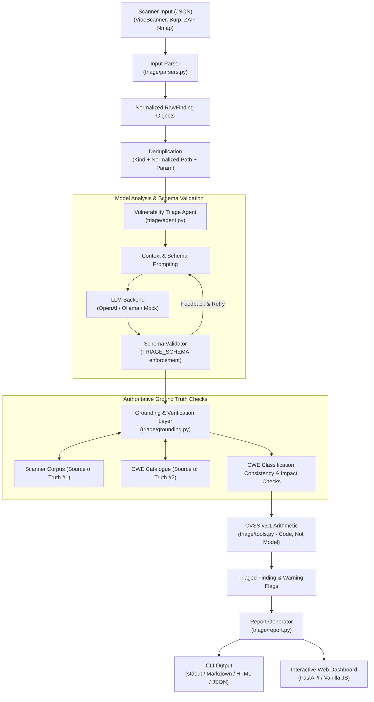

# Vulnerability Triage Agent

An automated, AI-assisted vulnerability triage system that transforms raw security scanner findings into client-ready penetration testing reports while enforcing deterministic grounding checks to prevent LLM hallucinations.

---

## 1. Project Overview

Modern vulnerability scanners produce high volumes of raw findings that require manual interpretation, deduplication, weakness categorization, CVSS scoring, reproduction documentation, and remediation recommendations.

The **Vulnerability Triage Agent** automates this pipeline using language models under strict constraints:
- **Judgement is separated from calculation:** Models select CVSS v3.1 qualitative metrics, but base scores are derived strictly by code.
- **Claims are verified against ground truth:** Every CVE reference, CWE identifier, URL endpoint, and impact claim is validated against raw scanner evidence and an authoritative CWE catalogue.
- **Hallucinations are detected and redacted:** Untraceable or fabricated citations are flagged for human review and redacted from final reports.

---

## 2. Problem Statement

Automating security report generation with LLMs introduces significant operational risk:
1. **Fabricated CVE Citations:** Under pressure to provide authoritative references, LLMs often hallucinate nonexistent CVE numbers (e.g., claiming a custom web application flaw corresponds to `CVE-2019-4471`).
2. **Incorrect CVSS Math:** Generative models are notoriously unreliable at arithmetic, frequently inventing inconsistent base scores and severity ratings.
3. **Misclassification & Scope Drift:** Models often confuse vulnerability types (e.g., assigning Path Traversal to a SQL injection) or fabricate endpoints never touched during the assessment.
4. **Self-Auditing Failure:** Asking an LLM if its own output is factual fails because the model generates confident justifications for its own fabrications.

---

## 3. Key Features

- **Multi-Scanner Ingestion:** Supports VibeScanner, Burp Suite (Professional XML/JSON & Enterprise REST), OWASP ZAP, and Nmap JSON formats.
- **Intelligent Deduplication:** Merges identical vulnerability findings across repeated endpoints and query parameters.
- **Schema-Enforced Elicitation:** Constrains LLM completions to a strict JSON Schema, automatically retrying with diagnostic feedback on validation errors.
- **Deterministic CVSS v3.1 Calculator:** Implements FIRST CVSS v3.1 Appendix A formulas to compute exact base scores and qualitative severity ratings.
- **Deterministic Grounding Verification:** Validates every generated statement against scanner evidence and a local CWE catalogue without relying on LLM self-evaluation.
- **Dual-View Inspection Interface:** A FastAPI-based web UI that provides side-by-side comparison between raw model output and grounded results.
- **Multi-Format Export:** Generates standardized Markdown, self-contained responsive HTML, and structured JSON reports.
- **Zero-Dependency Core CLI:** Core triage, scoring, and report generation run on the Python standard library without requiring external packages or API keys.

---

## 4. System Architecture

The following diagram illustrates how raw scanner inputs flow through parsing, agent orchestration, verification checks, and final report rendering:



---

## 5. Technology Stack

- **Core & Runtime:** Python 3.10+ (standard library: `dataclasses`, `json`, `urllib`, `argparse`, `math`, `re`)
- **Web Interface:** FastAPI, Starlette, Jinja2, Uvicorn
- **Supported LLM Backends:**
  - `openai`: OpenAI API (`gpt-4o-mini`, `gpt-4o`) via `openai` Python SDK
  - `ollama`: Local offline inference (`llama3.2`, `mistral`) via standard HTTP API
  - `mock`: Seeded, deterministic simulation for CI and repeatable evaluations
- **Testing & Quality:** Pytest, HTTPX

---

## 6. Project Structure

```
vuln-triage-agent/
├── triage/                      # Core triage engine & domain logic
│   ├── __init__.py              # Package entrypoint & version metadata
│   ├── agent.py                 # Triage agent orchestration & retry loops
│   ├── cli.py                   # Command-line interface definition
│   ├── grounding.py             # Grounding rules, consistency checks & redaction
│   ├── llm.py                   # LLM backends (OpenAI, Ollama, Mock)
│   ├── models.py                # Plain dataclasses & JSON schema definitions
│   ├── parsers.py               # Ingestion parsers (VibeScanner, Burp, ZAP, Nmap)
│   ├── report.py                # Markdown, HTML, and JSON report formatters
│   └── tools.py                 # CVSS v3.1 calculator, CWE lookup, deduplication
│
├── webui/                       # Interactive Web Dashboard
│   ├── __init__.py              # Web package initialization
│   ├── app.py                   # FastAPI route handlers & API endpoints
│   ├── security.py              # Rate limiting, input validation & render guards
│   ├── static/                  # Vanilla CSS stylesheets & JavaScript
│   └── templates/               # Jinja2 HTML dashboard template
│
├── data/                        # Authoritative catalogues and sample inputs
│   ├── cwe.json                 # Curated CWE weakness dictionary & mitigations
│   └── sample_scan.json         # Realistic multi-vulnerability scanner payload
│
├── evals/                       # Hallucination measurement harness
│   ├── results.json             # Benchmark results on mock simulation
│   ├── results_ollama.json      # Benchmark results on local Llama 3.2
│   └── run_eval.py              # Script measuring ungrounded claims with grounding on/off
│
├── reports/                     # Pre-rendered sample reports
│   ├── sample_report.html       # Standalone styled HTML assessment report
│   ├── sample_report.json       # Structured machine-readable report
│   └── sample_report.md         # Formatted Markdown report
│
├── tests/                       # Automated test suite
│   ├── test_triage.py           # Engine, CVSS math, parsers & grounding tests
│   └── test_webui.py            # API endpoint, security guards & rendering tests
│
├── .gitignore                   # Version control exclusion rules
├── LICENSE                      # MIT Open Source License
├── Procfile                     # Deployment process definition
├── pyproject.toml               # Package build configuration & dependencies
├── README.md                    # Project documentation
├── render.yaml                  # Blueprint for zero-configuration Cloud deployment
└── requirements.txt             # Pinned project dependencies
```

---

## 7. Installation

### Prerequisites
- Python 3.10 or higher
- Git

### 1. Clone the repository
```bash
git clone https://github.com/venky099/vuln-triage-agent.git
cd vuln-triage-agent
```

### 2. Create and activate a virtual environment
```bash
# On Linux / macOS:
python3 -m venv .venv
source .venv/bin/activate

# On Windows (PowerShell):
python -m venv .venv
.venv\Scripts\Activate.ps1
```

### 3. Install dependencies
```bash
# Core CLI only (Zero external dependencies):
pip install -e .

# Full installation (Web UI, testing, and OpenAI support):
pip install -r requirements.txt && pip install -e .
```

---

## 8. Configuration

Environment variables configure backend selection and server security controls:

| Variable | Default | Purpose |
|---|---|---|
| `LLM_BACKEND` | Auto-detected | Forces `mock`, `ollama`, or `openai`. |
| `LLM_MODEL` | Provider default | Model name (e.g. `gpt-4o-mini` or `llama3.2`). |
| `OPENAI_API_KEY` | None | API key for OpenAI backend. |
| `OLLAMA_HOST` | `http://127.0.0.1:11434` | Network address of local Ollama daemon. |
| `TRIAGE_RATE` | `15` | Maximum requests per minute per IP on web endpoints. |
| `TRIAGE_PROXY_DEPTH` | `1` | Reverse proxy depth for parsing `X-Forwarded-For`. |

---

## 9. Usage

### Command-Line Interface (CLI)

```bash
# Triage a scan and output Markdown to stdout using auto-detected backend
vulntriage data/sample_scan.json

# Specify report target and export styled HTML
vulntriage data/sample_scan.json --target "staging.example.com" -f html -o report.html

# Export structured JSON report
vulntriage data/sample_scan.json -f json -o report.json

# Explicitly choose backend
vulntriage data/sample_scan.json --backend mock
vulntriage data/sample_scan.json --backend ollama
vulntriage data/sample_scan.json --backend openai

# Enable verbose debug logging
vulntriage data/sample_scan.json -v
```

### Interactive Web Dashboard

Start the local dashboard:
```bash
uvicorn webui.app:app --reload --port 8000
```
Open `http://localhost:8000` in a browser to:
1. Load or paste scanner output JSON.
2. Select the execution backend (Simulated Mock, Local Ollama, or OpenAI).
3. Toggle between **Raw Output** and **After Checks** to inspect redacted claims.
4. Export finalized reports in Markdown, HTML, or JSON.

---

## 10. Sample Input

Below is a typical scanner JSON finding accepted by the system (`data/sample_scan.json`):

```json
{
  "target": "https://demo.vulnerable.example",
  "scanner": "VibeScanner",
  "findings": [
    {
      "id": "VS-001",
      "type": "SQL Injection",
      "url": "https://demo.vulnerable.example/product?id=1",
      "parameter": "id",
      "method": "GET",
      "payload": "1' OR '1'='1",
      "evidence": "MySQL syntax error present in response body."
    }
  ]
}
```

---

## 11. Sample Output

### Generated Markdown Report (Excerpt)

```markdown
### 1. SQL Injection in id at https://demo.vulnerable.example/product?id=1

**Severity:** Critical (9.8)  
**CVSS v3.1:** `CVSS:3.1/AV:N/AC:L/PR:N/UI:N/S:U/C:H/I:H/A:H`  
**Weakness:** CWE-89 — SQL Injection  
**Source:** VS-001 (also seen as VS-002)

The id parameter is concatenated into a SQL query. A crafted value changes the meaning of the query, exposing the database behind https://demo.vulnerable.example/product?id=1.

**Reproduction**
Send a GET request to https://demo.vulnerable.example/product?id=1 with id=1' OR '1'='1 and compare the response against a benign value.

**Remediation**
Use parameterised queries so id is bound as a value and never parsed as SQL.
```

If an ungrounded or fabricated claim is detected, it is visibly marked:
```markdown
**⚠ Needs review before sending:**
- invented CVE reference: CVE-2019-3253
```

---

## 12. Evaluation and Testing

### Automated Test Suite
The repository includes **115 automated unit and regression tests** covering CVSS math, parsers, schema compliance, rate limiting, and security validation:

```bash
pytest -v
```

### Hallucination Measurement (`evals/run_eval.py`)
The evaluation script synthesizes findings to measure hallucination rates across identical runs with grounding disabled vs. enabled:

```bash
# Run 50-finding simulation test
python evals/run_eval.py -n 50 --backend mock

# Run evaluation on local Ollama instance
python evals/run_eval.py -n 20 --backend ollama
```

#### Benchmark Summary:
- **Simulated Adversarial Mock (50 findings):**
  - Grounding OFF: 18% of findings contained ungrounded claims (invented CVEs or unregistered CWEs).
  - Grounding ON: 100% of invalid claims were flagged and intercepted; 0 leaked into final reports.
- **Local Llama 3.2 (3B) Evaluation (20 findings):**
  - Grounding OFF: 0 invented citations, demonstrating that strict schema design and negative system prompts prevent most hallucinations upstream.

---

## 13. Security Considerations

- **Indirect Prompt Injection Defense:** System instructions explicitly order the LLM to treat all scanner payloads, headers, and evidence as untrusted data.
- **No API Key Storage:** In the web UI, client-provided API keys are held in request scope only, never written to disk, and never included in error logs.
- **Server Log Isolation:** Errors logged to server consoles record technical stack traces without exposing user tokens or sensitive finding data.
- **Strict Web Request Validation:** The `/api/render` endpoint validates string lengths, numerical CVSS boundaries, qualitative severity values, and list limits to protect against Denial of Service (DoS) and data corruption.
- **In-Memory Thread-Safe Rate Limiting:** Sliding-window rate limiting protects single-instance deployments against brute-force or flooding attacks.
- **Context-Aware HTML Escaping:** Pre-rendered HTML reports escape all dynamic and client-controlled inputs, mitigating Cross-Site Scripting (XSS).

---

## 14. Known Limitations

- **Lexical Matching:** Grounding checks currently compare endpoints and tokens lexically. A subtly incorrect technical statement composed entirely of words present in the scan evidence will not be caught.
- **Catalogue Size:** The bundled CWE catalogue contains 16 representative web vulnerability classes. Legitimate CWEs outside this catalogue are flagged for verification.
- **Impact Phrase List:** Overclaim detection uses regex patterns. Novel expressions of extreme impact may bypass pattern filters.
- **Single Instance Limiter:** The in-memory rate limiter is designed for single-node deployments; horizontal scaling requires an external cache.

---

## 15. Future Improvements

- **Semantic Embedding Grounding:** Complement lexical checks with vector similarity checks against authoritative security knowledge bases.
- **SARIF Standard Support:** Add a native parser for OASIS SARIF (Static Analysis Results Interchange Format) to support SAST scanners.
- **Expanded CWE Catalog:** Expand the reference dataset to include the complete CWE Top 25 and OWASP Top 10 2021 catalogues.
- **Automated Verification Probes:** Optional active verification plugins to replay HTTP reproduction steps against non-production endpoints.

---

## 16. License

This project is licensed under the terms of the [MIT License](LICENSE).
